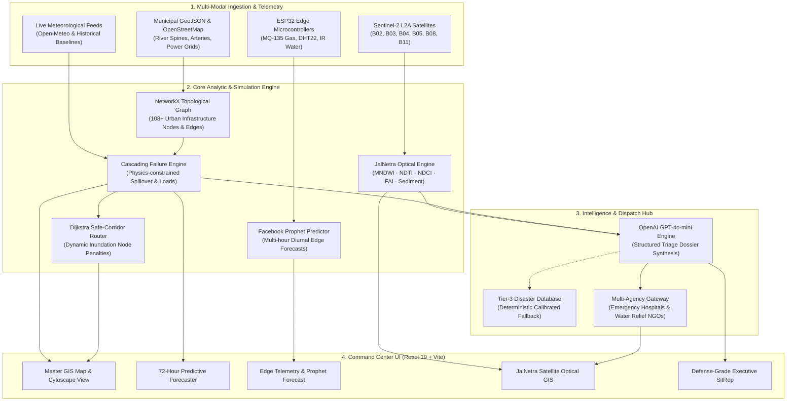

# 🌐 CityGraph: Autonomous Urban Infrastructure Cascade & Optical Intelligence Platform

[](https://www.python.org/)
[](https://fastapi.tiangolo.com/)
[](https://react.dev/)
[](https://vitejs.dev/)
[](https://sentinels.copernicus.eu/)
[](https://openai.com/)
[](https://pytest.org/)
[](https://oxc.rs/)
[](LICENSE)

**CityGraph** is a defense-grade urban risk intelligence and multi-hazard cascading failure modeling platform designed for metropolitan resilience. It combines topological graph theory, physics-constrained cascade propagation, satellite optical water surveillance (Sentinel-2 L2A), edge telemetry forecasting (Prophet), and an OpenAI-integrated emergency dispatch engine for trauma hospitals and water relief NGOs.

---

## 📑 Table of Contents
- [Executive Overview & Core USP](#-executive-overview--core-usp)
- [System Architecture](#-system-architecture)
- [Operational Modules & Key Capabilities](#-operational-modules--key-capabilities)
- [JalNetra Optical Water Quality Engine](#-jalnetra-optical-water-quality-engine)
- [API Reference & Endpoint Directory](#-api-reference--endpoint-directory)
- [Multi-City Disaster Database](#-multi-city-disaster-database)
- [Quick Start Guide](#-quick-start-guide)
- [Environment Variables & Configuration](#-environment-variables--configuration)
- [Testing & Quality Verification](#-testing--quality-verification)
- [License & Attributions](#-license--attributions)

---

## ⚡ Executive Overview & Core USP

Traditional disaster and municipal GIS systems are fundamentally **siloed and retrospective**: they plot floods on maps or track water quality on separate dashboards without understanding **cross-infrastructure dependency loops**. 

CityGraph bridges these domains through four foundational architectural breakthroughs:

```
┌──────────────────────────────────────────────────────────────────────────────────┐
│                             CITYGRAPH CORE USP PILLARS                           │
├─────────────────────────┬────────────────────────────┬───────────────────────────┤
│ 1. Interdependent       │ 2. JalNetra Optical        │ 3. Automated OpenAI       │
│    Cascade Physics      │    Water Intelligence      │    Multi-Agency Dispatch  │
│ Cross-sector dependency │ Satellite BOA reflectance  │ Dynamic synthesis of      │
│ between power, transit, │ formulas (MNDWI, NDTI,     │ clinical protocols & NGO  │
│ pumps & emergency trauma│ NDCI, FAI) for Delhi &     │ field containment tasks   │
│ care triage centers.    │ Mumbai waterbodies.        │ with live notification.   │
├─────────────────────────┼────────────────────────────┼───────────────────────────┤
│ 4. 72h Predictive       │ 5. Physical Edge           │ 6. Dijkstra Multi-        │
│    Cascade Forecaster   │    Sensor Telemetry        │    Corridor Evacuation    │
│ 4-state probability with│ Real-time ESP32 telemetry  │ Dynamic re-routing with   │
│ 10-second live sensor   │ (MQ-135, DHT, IR) with     │ flooded-asset avoidance   │
│ pulse & nominal feed.   │ Prophet forward curves.    │ and safe-haven corridors. │
└─────────────────────────┴────────────────────────────┴───────────────────────────┘
```

---

## 🏛️ System Architecture



---

## 🕹️ Operational Modules & Key Capabilities

### 1. 🗺️ Master GIS Command Center & Topology Graph
- **OpenStreetMap Basemap**: Clean Leaflet integration with zero proprietary API key watermarks.
- **Cytoscape Topological Network**: Interactive force-directed dependency layout modeling cross-sector linkages between transformers, drainage pumps, hospitals, and transit hubs.
- **Dynamic Layer Filtering**: Instant toggling of floodplains, power substations, fire stations, hospitals, and arterial roads.

### 2. ⏱️ 72-Hour Warning System & 10s Live Simulation Pulse
- **Nominal All-Green Live Feed (`live_feed`)**: Default baseline operating strictly at nominal risk ($<35\%$) across all urban zones with zero false positives.
- **10-Second Auto-Pulse**: Live background ticker refreshing micro-fluctuations modeled after diurnal drift and stochastic environmental noise.
- **4-State Zonal Risk Probabilities**: Real-time calibration across `NORMAL`, `WATCH`, `HIGH RISK`, and `CRITICAL` states.
- **Counterfactual Intervention Planning**: Evaluate the mitigating impact of dewatering pumps, backup generator dispatches, and traffic diversions before deployment.

### 3. 📡 Physical Edge Sensor Telemetry & Prophet Forecast
- **Direct ESP32 Hardware Emulation**:
  - **MQ-135 Gas / Air Quality Sensor**: Ambient ppm monitoring ($400 - 1500\text{ ppm}$).
  - **DHT22 Temperature & Humidity**: Real-time thermal and saturation profiling.
  - **IR Water Level Sensor**: Discrete and analog inundation stage detection ($0.0 - 2.5\text{ m}$).
- **Prophet Predictive Forward Engine**: Computes 6-hour forward-looking projections with $95\%$ confidence bounds and trend decomposers.

### 4. 🚨 Multi-Corridor Emergency Evacuation Routing
- **Hazard-Aware Dijkstra**: Calculates shortest accessible evacuation paths while automatically routing around inundated or structurally failed nodes.
- **Interactive A/B Dispatch**: Click any operational origin node and destination hospital to generate turn-by-turn guidance.

### 5. 📄 Defense-Grade Executive Situation Reports (SitRep)
- **Automatic Incident Dossier Generation**: Formatted to official disaster management guidelines (`DOC-ID`, executive summary, breach telemetry, response directives).
- **OpenAI Dynamic Synthesis**: Deep situational analysis with local database Tier-3 offline fallbacks.

---

## 💧 JalNetra Optical Water Quality Engine

The **JalNetra Optical Intelligence Engine** computes five standardized optical water quality formulas over **Bottom-Of-Atmosphere (BOA)** surface reflectance from **Sentinel-2 L2A**:

| Band Key | Center Wavelength | Native Resolution | Role in Optical Analysis |
|:---:|:---:|:---:|:---|
| **B02** | $490\text{ nm}$ (Blue) | $10\text{ m}$ | Atmospheric scattering correction & deep water penetration |
| **B03** | $560\text{ nm}$ (Green) | $10\text{ m}$ | Open water detection reference & turbidity denominator |
| **B04** | $665\text{ nm}$ (Red) | $10\text{ m}$ | Suspended particulate scattering & chlorophyll absorption |
| **B05** | $705\text{ nm}$ (Red Edge) | $20\text{ m} \rightarrow 10\text{ m}$ | Phytoplankton reflectance peak (Chlorophyll-a biomass) |
| **B08** | $842\text{ nm}$ (NIR) | $10\text{ m}$ | Pure water absorption & floating vegetation reflection |
| **B11** | $1610\text{ nm}$ (SWIR) | $20\text{ m} \rightarrow 10\text{ m}$ | Water boundary delineation & moisture absorption |

### Optical Index Formulas
1. **Water Extent (MNDWI)**:
   $$\text{MNDWI} = \frac{\rho_{B03} - \rho_{B11}}{\rho_{B03} + \rho_{B11}} > 0.0 \implies \text{Open Water Pixel}$$
2. **Turbidity Index (NDTI)**:
   $$\text{NDTI} = \frac{\rho_{B04} - \rho_{B03}}{\rho_{B04} + \rho_{B03}} \quad (\text{rises with suspended sediment load})$$
3. **Chlorophyll-a / Algal Bloom (NDCI)**:
   $$\text{NDCI} = \frac{\rho_{B05} - \rho_{B04}}{\rho_{B05} + \rho_{B04}} \quad (\text{detects organic enrichment and eutrophication})$$
4. **Floating Algae Index (FAI)**:
   $$\text{FAI} = \rho_{B08} - \left[\rho_{B04} + (\rho_{B11} - \rho_{B04}) \times \frac{842 - 665}{1610 - 665}\right] \quad (\text{surface scum detection})$$
5. **Suspended Silt / Sediment Reflectance**:
   $$\text{Sediment} = \rho_{B04} \quad (\text{evaluated over valid open water})$$

### Automated Hospital & NGO Emergency Dispatch
When an anomaly reaches `WATCH`, `ADVISORY`, or `ALERT` levels, the operator can transmit an automated AI-synthesized advisory to nearby verified institutions:
- **Emergency Trauma Hospitals**: AIIMS Apex Trauma, Safdarjung Epidemic Ward, KEM Memorial Hospital, Hiranandani Powai.
- **Civic Water Relief NGOs**: Yamuna Jiye Abhiyan, FORCE Water Security, Pani Haq Samiti, Vanashakti.

---

## 🔌 API Reference & Endpoint Directory

All endpoints are hosted by default on `http://127.0.0.1:8000`:

### 1. System & Authentication
| Method | Endpoint | Description |
|:---:|:---|:---|
| `GET` | `/api/health` | Service health status and live connector connectivity |
| `POST` | `/api/auth/token` | OAuth2 password bearer token exchange |
| `POST` | `/api/auth/register` | New disaster management operator registration |
| `GET` | `/api/auth/me` | Current authenticated operator session profile |

### 2. Simulation & Cascading Failure Graph
| Method | Endpoint | Description |
|:---:|:---|:---|
| `GET` | `/api/graph` | Full city topological network (nodes, capacities, corridors) |
| `POST` | `/api/simulate` | Trigger physics-constrained cascading failure propagation |
| `POST` | `/api/reset` | Restore infrastructure graph to nominal baseline |
| `POST` | `/api/route` | Compute Dijkstra safe corridor avoiding inundated nodes |

### 3. 72-Hour Predictive Warning System
| Method | Endpoint | Description |
|:---:|:---|:---|
| `GET` | `/api/warning/state` | Multi-horizon risk states, zonal probabilities & twin metrics |
| `GET` | `/api/warning/live-tick` | 10-second real-time telemetry pulse generation |
| `GET` | `/api/warning/scenarios` | Directory of pre-configured multi-city crisis scenarios |
| `POST` | `/api/warning/scenario` | Activate active crisis scenario (Cloudburst, Dam Release, etc.) |

### 4. Edge Sensors & Prophet Forecast
| Method | Endpoint | Description |
|:---:|:---|:---|
| `GET` | `/api/sensors/current` | Live ESP32 readings (MQ-135, DHT22 Temp/Humidity, IR Water) |
| `GET` | `/api/sensors/history` | Historical telemetry log buffer (diurnal variations) |
| `GET` | `/api/sensors/forecast` | Prophet model forecast curves with 95% uncertainty intervals |

### 5. JalNetra Optical Water Microservice
| Method | Endpoint | Description |
|:---:|:---|:---|
| `GET` | `/api/v1/water-quality/health` | JalNetra optical engine status |
| `GET` | `/api/v1/cities` | List monitored waterbody presets and nearby medical centers |
| `GET` | `/api/v1/water-quality/city/{key}` | Analyze preset waterbody (Delhi Yamuna, Mumbai Powai, etc.) |
| `GET` | `/api/v1/water-quality/point` | On-demand optical analysis for custom `lat`/`lon` coordinates |
| `POST` | `/api/v1/water-quality/dispatch-alert` | Synthesize & dispatch OpenAI emergency hospital/NGO alert |

### 6. Situation Reports (SitRep)
| Method | Endpoint | Description |
|:---:|:---|:---|
| `GET` | `/api/reports/cases` | Retrieve catalog of historical & simulated SitRep dossiers |
| `POST` | `/api/reports/generate` | Synthesize dynamic hyper-local executive SitRep dossier |

---

## 🏙️ Multi-City Disaster Database

CityGraph includes complete demographic, structural, and geographic models for four major regional metropolitan areas:

| City ID | Metropolitan Region | Primary Hazard Vector | Benchmark Real-World Period |
|:---|:---|:---|:---|
| `delhi_ncr` | **Delhi National Capital Territory** | Yamuna River Breach & Urban Flash Inundation | July 2023 Monsoon Deluge |
| `mumbai_coastal` | **Mumbai Coastal Megacity** | High-Tide Mithi River Surcharge & Urban Depression | 26 July Historical Floods |
| `kathmandu_valley` | **Kathmandu Valley, Nepal** | Bagmati Floodplain & Transboundary Runoff | October 2024 Surcharge |
| `bengaluru_tech_corridor`| **Bengaluru Tech Corridor** | Bellandur / Varthur Lake Spillways & Grid Stress | September 2022 Flash Flooding |

---

## 🚀 Quick Start Guide

### Prerequisites
- Python 3.10+ (Python 3.12 recommended)
- Node.js 18+ and npm
- Git

### 1. Backend Setup
```bash
# Clone the repository
git clone https://github.com/rajsalonia/citygraph.git
cd citygraph

# Create and activate virtual environment
python3 -m venv .venv
source .venv/bin/activate

# Install dependencies
pip install -r requirements.txt
pip install -r requirements_service.txt

# Configure environment variables
cp .env.example .env

# Launch the FastAPI backend (with hot-reload)
python3 -m uvicorn main:app --app-dir backend --port 8000 --reload
```
API Documentation will be live at: **`http://localhost:8000/docs`**

### 2. Standalone JalNetra Microservice (Optional)
The JalNetra microservice is mounted inside the main backend, but can also run independently:
```bash
python3 water_quality_service.py
# Runs standalone on http://localhost:8050
```

### 3. Frontend Setup
```bash
cd frontend

# Install dependencies
npm install

# Start Vite development server
npm run dev
```
The application will be accessible at: **`http://localhost:5173`**

---

## 🔑 Environment Variables & Configuration

Create a `.env` file in the project root:

```env
# Application Settings
ENVIRONMENT=development
PORT=8000
ENABLE_DOCS=true

# Security & Database
SECRET_KEY=your_random_secret_key_here
ACCESS_TOKEN_EXPIRE_MINUTES=1440
DATABASE_URL=sqlite:///./citygraph.db
CORS_ORIGINS=http://localhost:5173,http://localhost:5174,http://127.0.0.1:5173

# Admin Setup
SEED_DEFAULT_USER=true
INITIAL_ADMIN_EMAIL=admin@citygraph.org
INITIAL_ADMIN_PASSWORD=IncidentCommander2026!

# Live Data & External Integrations
USE_LIVE_FEEDS=true
OPENAI_API_KEY=sk-proj-your-openai-api-key-here
TOMTOM_API_KEY=your_tomtom_api_key
MAPBOX_API_KEY=your_mapbox_key
```

---

## 🧪 Testing & Quality Verification

CityGraph maintains strict automated quality control across the stack:

```bash
# Run complete Python test suite (91 tests)
pytest -q

# Run frontend linter (Oxlint)
cd frontend && npm run lint

# Run production build
cd frontend && npm run build
```

Current test status:
- **Python Unit & Integration Tests**: `91 / 91 PASSED` (100% passing across warnings, sensors, water quality, and cascade engine).
- **Frontend Code Quality**: `0 warnings, 0 errors` across 39 modules.
- **Vite Build**: Production assets cleanly compiled in `<1s`.

---

## 📄 License & Attributions

This project is licensed under the **MIT License** — see the [LICENSE](LICENSE) file for details.

### Geospatial & Data Attributions
- **Sentinel-2 L2A Multispectral Imagery**: Copernicus Open Access Hub / European Space Agency (ESA).
- **Cartographic Tiles & Topography**: © [OpenStreetMap](https://www.openstreetmap.org/copyright) contributors, CARTO.
- **Elevation & Meteorological Data**: Open-Meteo, NASA SRTM, Indian Meteorological Department (IMD) historical archives.
